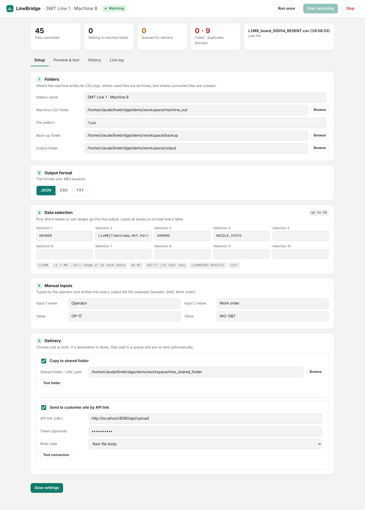
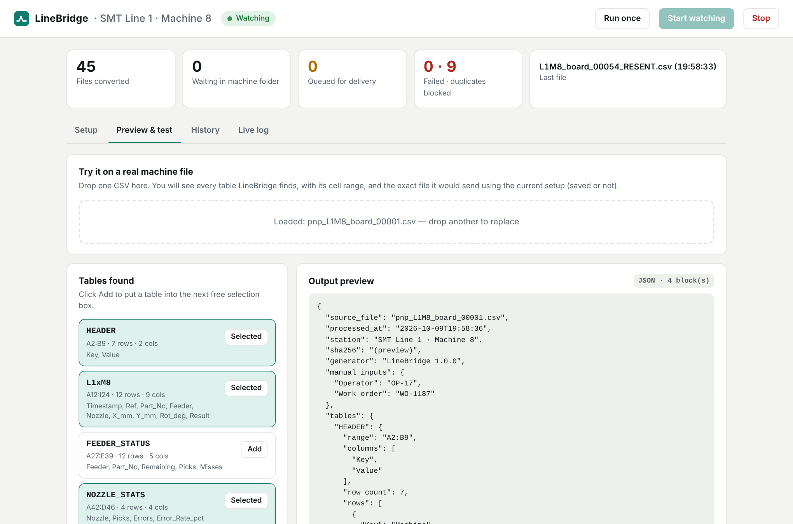
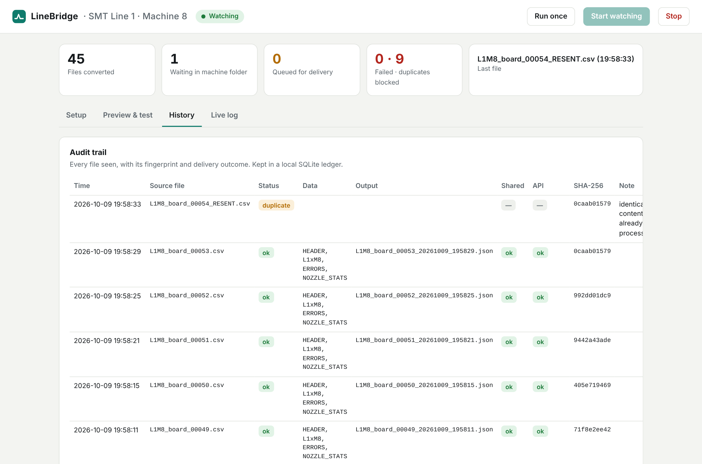

**\*\*# LineBridge\*\***

**\*\*\\\*\\\*Turns the CSV logs that assembly machines already write into the exact files a factory's MES expects, then delivers, archives and audits them, with no changes to the machine.\\\*\\\*\*\***

*\*> Every CNC / SMT machine on an electronics assembly line logs each action to CSV.\**

*\*> Every factory's MES (Manufacturing Execution System) wants that data in its own format, over its own channel.\**

*\*> LineBridge sits in the middle on the machine PC, needs nothing but Python, and closes that gap in minutes instead of a custom integration project.\**

---

**\*\*## Contents\*\***

1. [The problem](#1-the-problem)

2. [Why it matters](#2-why-it-matters)

3. [What LineBridge does](#3-what-linebridge-does)

4. [Quick start (2 minutes)](#4-quick-start)

5. [How it works](#5-how-it-works)

6. [Selecting data: tables, cell ranges, columns](#6-selecting-data)

7. [Output formats](#7-output-formats)

8. [Delivery: shared folder and API](#8-delivery)

9. [Reliability features](#9-reliability-features)

10. [What makes it different](#10-what-makes-it-different)

11. [Existing solutions and where LineBridge fits](#11-existing-solutions)

12. [Project structure](#12-project-structure)

13. [Configuration reference](#13-configuration-reference)

14. [Deploying on a factory PC](#14-deploying-on-a-factory-pc)

15. [Testing](#15-testing)

16. [Roadmap](#16-roadmap)

**## 🎥 Project Demo — Web & Desktop Applications**

Watch the complete implementation and execution walkthrough, covering both the web application and the desktop application.

[![Project Demo — Web & Desktop Applications]\(https\://img.youtube.com/vi/U8hpWJG6ORg/0.jpg)]\(https\://youtu.be/U8hpWJG6ORg)

▶️ **[Watch the Full Demo on YouTube](https://youtu.be/UYU5B8hAyhs')**

**### What the Demo Covers**

\- 🌐 **\*\*Web Application:\*\*** Interface and the implemented file-processing workflow.

\- 🖥️ **\*\*Desktop Application:\*\*** Desktop interface, configuration, and execution workflow.

\- 📁 **\*\*File Processing:\*\*** Processing status, generated outputs, and review of results.

\- 🔗 **\*\*Delivery Options:\*\*** Configuration options for connecting to external destinations.

The video demonstrates the implemented workflows across both applications, from providing machine data to generating and reviewing processed outputs.

## 📄 PDF Output Enhancement — Demo

The latest update adds **PDF as an additional output format** alongside JSON, CSV, and TXT. The walkthrough demonstrates the PDF enhancement.

▶️ **[Watch the PDF Output Enhancement Demo on YouTube](https://youtu.be/UYU5B8hAyhs)**

- Select PDF as the output format in the application.
- Generate and download a PDF report from the Preview & test workflow.
- Review the generated report containing machine data and relevant metadata.
- PDF output is also documented for the regular processing workflow and configured delivery options.

\---

Also see: **\*\*\\\*\\\*[docs/SOLUTION_PLAN.md](\*\***&#x64;ocs/SOLUTION_PLAN.m&#x64;**\*\*)\\\*\\\*\*\*** (requirement-by-requirement design) and **\*\*\\\*\\\*[docs/PITCH.md](\*\***&#x64;ocs/PITCH.m&#x64;**\*\*)\\\*\\\*\*\*** (pitch script, demo flow, judge Q&A).

---

**\*\*## 1. The problem\*\***

In electronics assembly (pick-and-place, screen printers, reflow ovens, AOI, CNC routers), each machine writes a **\*\*\\\*\\\*record of every action\\\*\\\*\*\*** (part placed, nozzle used, position, result, errors) into a CSV file in a local folder. A new file arrives after every board or batch, continuously.

Integrated factories run a **\*\*\\\*\\\*third-party MES\\\*\\\*\*\*** to track production, traceability and quality. The trouble:

| Reality on the shop floor | Consequence |

|---|---|

| Every MES make uses **\*\*\\\*\\\*different protocols\\\*\\\*\*\*** to talk to machines | A connector must be built per MES × per machine model |

| The MES usually wants **\*\*\\\*\\\*a different format\\\*\\\*\*\*** than the machine's CSV (JSON, a flat CSV, fixed TXT) | Someone has to transform the files |

| One machine CSV contains **\*\*\\\*\\\*many tables\\\*\\\*\*\*** (header, placements, feeders, nozzles, errors), but the MES needs only some | Data must be picked out precisely, e.g. *\*\\\*L1 × M8\\\*\** |

| Context the machine doesn't know (**\*\*\\\*\\\*operator, shift, work order\\\*\\\*\*\***) must travel with the data | It has to be typed in and merged |

| Delivery differs per customer: **\*\*\\\*\\\*a shared network folder\\\*\\\*\*\*** for some, **\*\*\\\*\\\*a web API link\\\*\\\*\*\*** for others | Two delivery paths, and either can be down |

| New files keep arriving | Processed files must be **\*\*\\\*\\\*moved to a back-up folder\\\*\\\*\*\*** so only fresh files are picked up, and nothing is lost |

Today this is solved with manual copying, one-off scripts that break silently, or expensive vendor integration projects.

**\*\*## 2. Why it matters\*\***

\\- **\*\*\\\*\\\*Traceability is mandatory\\\*\\\*\*\*** in automotive, medical and aerospace electronics. If a board fails in the field, the factory must prove which part, feeder and nozzle placed each component. Missing or late machine data means failed audits and wider recalls.

\\- **\*\*\\\*\\\*Legacy machines are the majority.\\\*\\\*\*\*** Modern standards like IPC-CFX need the machine vendor to support them. Older machines, which keep running for many years, only write files.

\\- **\*\*\\\*\\\*Manual handling is slow and error-prone.\\\*\\\*\*\*** Copying files by hand loses data on night shifts, duplicates data when a file is copied twice, and gives no proof of what was sent.

\\- **\*\*\\\*\\\*Every new customer or MES means rework.\\\*\\\*\*\*** Contract manufacturers serve many customers, each with its own MES and format.

LineBridge makes the existing CSV the integration point. If the machine can write a file, it can feed any MES.

**\*\*## 3. What LineBridge does\*\***

\\\`\\\`\\\`

&#x20;Machine writes CSV ─► LineBridge (on the machine PC) ─► MES-ready JSON / CSV / TXT / PDF

&#x20;                        │  pick tables (up to 10)          ├─► shared folder (\\\\\MES\inbox)

&#x20;                        │  add 2 manual inputs             └─► customer API link (HTTPS)

&#x20;                        │  archive original to back-up

&#x20;                        └─ record everything in an audit ledger

\\\`\\\`\\\`

| Your requirement | LineBridge feature |

|---|---|

| 1. CSV files arrive in a folder one by one | Folder watcher, oldest first, waits until the machine has finished writing |

| 2. Pull the files from the folder | Automatic pickup, or **\*\*\\\*\\\*Run once\\\*\\\*\*\*** on demand |

| 3. Extract particular tables into JSON, CSV, TXT or PDF | Table detection + 4 output formats (CSV in *\*\\\*sections\\\*\** or *\*\\\*flat\\\*\** layout) |

| 4. User picks the table, e.g. L1 x M8 | Pick by **\*\*\\\*\\\*table name\\\*\\\*\*\*** (\\\`L1xM8\\\`), **\*\*\\\*\\\*Excel-style cell range\\\*\\\*\*\*** (\\\`L1:M8\\\`), with optional **\*\*\\\*\\\*column filter\\\*\\\*\*\*** |

| 5. Up to 10 selections + 2 manual inputs in the same file | 10 selection boxes + 2 name/value inputs written into every output |

| 6. Save to a shared folder **\*\*\\\*\\\*and/or\\\*\\\*\*\*** send by API, with a separate link field | Two independent destinations, each with on/off, its own settings and a **\*\*\\\*\\\*Test\\\*\\\*\*\*** button |

| 7. Move used files to a separate back-up folder | Originals moved into \\\`backup/YYYY-MM-DD/\\\`; failures to \\\`backup/\\\_failed/\\\`, re-sent copies to \\\`backup/\\\_duplicates/\\\` |

**\*\*## 4. Quick start\*\***

**\*\*### Supplied SECOM data\*\***

The supplied semiconductor sensor records are kept in [\\\`real_machine_logs/\\\`](real_machine_logs/README.md), with a ready profile in \\\`config.secom.json\\\`. On Windows, run \\\`start_panel.bat\\\` and press **\*\*\\\*\\\*Start watching\\\*\\\*\*\*** to process waiting CSV files. The app archives each batch after conversion, so the input folder empties as processing completes. The SECOM dataset is a historical collection of production entities, rather than continuously arriving machine logs.

The same folder now also accepts \\\`experiment_13.csv\\\`, a 2,233-row CNC machining log. The profile watches all CSV files and gives the experiment priority over any waiting SECOM batches.

Open the **\*\*\\\*\\\*Output viewer\\\*\\\*\*\*** tab to browse finished JSON, CSV, TXT, and PDF files in the configured output folder. JSON and CSV display as pageable tables with a column filter; TXT displays as a formatted report. Output names in **\*\*\\\*\\\*History\\\*\\\*\*\*** open the same viewer.

**\*\*\\\*\\\*Requirements:\\\*\\\*\*\*** Python 3.9 or newer. No packages to install, no internet needed. PDF generation also uses only the standard library; no additional dependencies are required.

\\\`\\\`\\\`bash

# Live demo: machine simulator + mock customer MES + LineBridge, all on this PC

python demo/run_demo.py --reset

\\\`\\\`\\\`

Two browser tabs open:

\\- **\*\*\\\*\\\*LineBridge control panel\\\*\\\*\*\***: http\\://localhost:8600

\\- **\*\*\\\*\\\*Customer MES inbox (mock)\\\*\\\*\*\***: http\\://localhost:8080

A new board log appears every few seconds and you can watch it get converted and delivered. Click **\*\*\\\*\\\*Simulate outage\\\*\\\*\*\*** on the MES page and the files queue up. Restore it and they are re-sent automatically. Every 6th file is a re-sent copy, which the duplicate guard blocks.

**\*\*### Proving the integration in a live demo\*\***

The control panel includes a beginner-friendly **\*\*\\\*\\\*Integration check\\\*\\\*\*\*** on the Setup tab. It verifies the machine input folder, parses a real or bundled sample CSV, checks the output and back-up paths, tests the shared-folder destination, and can send a small API test payload. A green **\*\*\\\*\\\*Ready\\\*\\\*\*\*** result is a visible proof that the configured path is connected.

For a complete presentation:

1. Run \\\\\\\`python demo/run_demo.py --reset\\\\\\\`.

2. Open \\\\\\\`http\\://localhost:8600\\\\\\\`, click **\*\*\\\*\\\*Run integration check\\\*\\\*\*\***, then **\*\*\\\*\\\*Start watching\\\*\\\*\*\***.

3. Open the customer MES page at \\\\\\\`http\\://localhost:8080\\\\\\\`, click **\*\*\\\*\\\*Simulate outage\\\*\\\*\*\***, wait for the queue to grow, and click **\*\*\\\*\\\*Restore service\\\*\\\*\*\***.

The **\*\*\\\*\\\*Preview & test\\\*\\\*\*\*** tab also has **\*\*\\\*\\\*Load bundled sample\\\*\\\*\*\***, so a first-time user can see table discovery and the exact JSON/CSV/TXT payload without finding a file manually. **\*\*\\\*\\\*Appearance\\\*\\\*\*\*** in the header provides system/light/dark/high-contrast themes and four text sizes; these preferences stay on the local browser and do not change the machine profile.

Windows users can double-click **\*\*\\\*\\\*\\\`start_demo.bat\\\`\\\*\\\*\*\*** instead.

**\*\*\\\*\\\*Use with a real machine:\\\*\\\*\*\***

\\\`\\\`\\\`bash

python -m linebridge ui --config config.json      # opens the control panel on http\\://localhost:8600

\\\`\\\`\\\`

Set the folders, pick tables, choose a format and delivery, click **\*\*\\\*\\\*Save\\\*\\\*\*\***, then **\*\*\\\*\\\*Start watching\\\*\\\*\*\***.

**\*\*## 5. How it works\*\***

\\\`\\\`\\\`mermaid

flowchart LR

&#x20;   M[Machine PC folder\\\ \\\*.csv] -->|stable for 2 s| D[Detect]

&#x20;   D --> F[Fingerprint\\\ SHA-256]

&#x20;   F -->|seen before| DUP[backup/\\\_duplicates]

&#x20;   F --> P[Parse into tables\\\ + cell ranges]

&#x20;   P --> S[Apply up to 10\\\ selectors]

&#x20;   S --> MI[Add 2 manual inputs\\\ + metadata]

&#x20;   MI --> R[Render JSON / CSV / TXT\\\ atomic write]

&#x20;   R --> SH[Shared folder]

&#x20;   R --> API[Customer API]

&#x20;   SH -. down .-> Q[(Outbox\\\ auto-retry)]

&#x20;   API -. down .-> Q

&#x20;   R --> B[Move source to\\\ backup/YYYY-MM-DD]

&#x20;   B --> L[(Audit ledger\\\ SQLite)]

&#x20;   P -. unreadable .-> FAIL[backup/\\\_failed]

\\\`\\\`\\\`

Step by step, for every file:

1. **\*\*\\\*\\\*Detect.\\\*\\\*\*\*** The watcher polls the machine folder (default every 3 s). A file is only touched once it has been unchanged for \\\`stable_seconds\\\`, so half-written files are never read.

2. **\*\*\\\*\\\*Fingerprint.\\\*\\\*\*\*** A SHA-256 hash is computed. If the same content was already delivered, the file is moved to \\\`backup/\\\_duplicates\\\` and not sent again.

3. **\*\*\\\*\\\*Parse.\\\*\\\*\*\*** The CSV is split into tables. A table is an optional title row (\\\`[L1xM8]\\\`, \\\`Table: L1xM8\\\`) followed by a header row and data rows, ending at a blank row. Trailing padding columns are removed. Each table remembers its spreadsheet range (e.g. \\\`A12:I24\\\`). Comma, semicolon and tab delimiters are auto-detected.

4. **\*\*\\\*\\\*Select.\\\*\\\*\*\*** Up to 10 selectors pick tables, cell ranges and columns (see §6).

5. **\*\*\\\*\\\*Enrich.\\\*\\\*\*\*** The 2 manual inputs, station name, source file name, processing time and SHA-256 are added.

6. **\*\*\\\*\\\*Render.\\\*\\\*\*\*** The output is written as JSON, CSV, TXT or PDF using an **\*\*\\\*\\\*atomic write\\\*\\\*\*\*** (temp file then rename), so an MES polling the folder never sees a partial file.

7. **\*\*\\\*\\\*Deliver.\\\*\\\*\*\*** The file is copied to the shared folder and/or POSTed to the API link. If a destination fails, the file goes into an **\*\*\\\*\\\*outbox\\\*\\\*\*\*** and is retried at the start of every cycle, in order.

8. **\*\*\\\*\\\*Archive.\\\*\\\*\*\*** The original CSV moves to \\\`backup/\\\<date>/\\\`, leaving the machine folder clean for the next file.

9. **\*\*\\\*\\\*Record.\\\*\\\*\*\*** One row goes into the SQLite audit ledger: time, file, hash, tables, output name, and the status of each destination.

**\*\*## 6. Selecting data\*\***

Each of the 10 selection boxes accepts:

| You type | Meaning |

|---|---|

| \\\`L1xM8\\\` | The table titled L1xM8. Case, spaces and \\\`×\\\` don't matter: \\\`l1 x m8\\\`, \\\`L1×M8\\\`, \\\`[L1xM8]\\\` all work |

| \\\`L2x\\\*\\\` | Every table matching the wildcard |

| \\\`L1:M8\\\` or \\\`L1 x M8\\\` | If **\*\*\\\*\\\*no table\\\*\\\*\*\*** has that name, it is read as an **\*\*\\\*\\\*Excel-style cell range\\\*\\\*\*\*** (columns L–M, rows 1–8). First row = column headers |

| \\\`A12:I\\\*\\\` | Range down to the **\*\*\\\*\\\*last row\\\*\\\*\*\***, useful when row counts vary per board |

| \\\`L1xM8[Ref, Result]\\\` | Only these columns, in this order (works for ranges too) |

| *\*\\\*(all empty)\\\*\** | Every table in the file |

*\*> Why both? "L1 x M8" is read on the floor both as \\\*Line 1 × Machine 8\\\* (a section in the log) and as a \\\*cell block\\\* in a spreadsheet. LineBridge supports both, and a named table always takes priority.\**

The **\*\*\\\*\\\*Preview & test\\\*\\\*\*\*** tab shows every table found in a real file with its cell range. One click adds a table to a selection box, and you see the exact output before going live.

**\*\*## 7. Output formats\*\***

Every output carries the same metadata: source file, processed time, station, SHA-256 of the source, generator version, and the manual inputs.

**\*\*\\\*\\\*JSON\\\*\\\*\*\*** (default)

\\\`\\\`\\\`json

{

&#x20; "source_file": "L1M8_board_00017.csv",

&#x20; "processed_at": "2026-10-09T19:55:45",

&#x20; "station": "SMT Line 1 · Machine 8",

&#x20; "sha256": "58331a41d30f911c37da2cd678d9771780b9b68fd42870ea97451d6d9fe638ae",

&#x20; "generator": "LineBridge 1.0.0",

&#x20; "manual_inputs": { "Operator": "OP-17", "Work order": "WO-1187" },

&#x20; "tables": {

&#x20;   "L1xM8": {

&#x20;     "range": "A12:I24",

&#x20;     "columns": ["Timestamp", "Ref", "Part_No", "Result"],

&#x20;     "row_count": 12,

&#x20;     "rows": [ { "Timestamp": "2026-10-09 10:00:00.581", "Ref": "R101", "Part_No": "RC0402-10K", "Result": "OK" } ]

&#x20;   }

&#x20; }

}

\\\`\\\`\\\`

**\*\*\\\*\\\*CSV, sections layout:\\\*\\\*\*\*** metadata lines starting with \\\`#\\\`, then one \\\`[table]\\\` block per selection.

**\*\*\\\*\\\*CSV, flat layout:\\\*\\\*\*\*** a single table, one row per record, with \\\`source_file, processed_at, table, \\\<manual *inputs*>, \\\<all *columns*>\\\`. This is the easiest layout for a database or MES import wizard.

**\*\*\\\*\\\*TXT:\\\*\\\*\*\*** an aligned, human-readable report for printing or for MES systems that read fixed-width text.

**\*\*\\\*\\\*PDF:\\\*\\\*\*\*** A printable landscape report with source metadata, manual inputs, selected tables, repeating column headers, and page numbers. Large tables continue across pages. PDF uses a dependency-free standard-library renderer; no package installation is required. Shared-folder and download delivery are supported. API delivery sends PDFs as application/pdf; confirm the receiving API accepts PDF files before enabling it.

**\*\*## 8. Delivery\*\***

| Destination | Details |

|---|---|

| **\*\*\\\*\\\*Shared folder\\\*\\\*\*\*** | Local path or UNC path (\\\`\\\\\MES-SERVER\inbox\\\`). Written atomically. **\*\*\\\*\\\*Test folder\\\*\\\*\*\*** checks it is writable |

| **\*\*\\\*\\\*API link\\\*\\\*\*\*** | \\\`POST\\\` to the URL entered in the panel. Body is either the **\*\*\\\*\\\*raw file\\\*\\\*\*\*** (\\\`Content-Type\\\` matches the format) or a **\*\*\\\*\\\*multipart form\\\*\\\*\*\*** upload (\\\`file\\\` + \\\`station\\\`). Headers: \\\`X-Filename\\\`, \\\`X-Station\\\`, \\\`X-Content-SHA256\\\`, and \\\`Authorization: Bearer \\\<token>\\\` if a token is set. **\*\*\\\*\\\*Test connection\\\*\\\*\*\*** sends a small test payload |

Both can be on at the same time. Each one is retried independently.

**\*\*## 9. Reliability features\*\***

| Risk on the floor | How LineBridge handles it |

|---|---|

| Machine still writing the file | File must be unchanged for \\\`stable_seconds\\\` before pickup |

| MES or network down | Output kept in \\\`output/\\\_outbox/\\\<destination>\\\`, retried every cycle in original order, ledger updated to \\\`ok (retried)\\\` |

| Same log re-sent by the machine or copied twice | SHA-256 duplicate guard; nothing is sent twice |

| Corrupt file or unexpected layout | Moved to \\\`backup/\\\_failed\\\`, error in the ledger and live log; the watcher keeps running |

| MES reads a half-copied file | Atomic writes everywhere (temp name + rename) |

| "Did we send board B240017 to the customer?" | Audit ledger with hash, time and per-destination status, visible in the **\*\*\\\*\\\*History\\\*\\\*\*\*** tab |

| PC reboot | Settings in \\\`config.json\\\`, ledger on disk, outbox on disk; restart and it continues |

**\*\*## 10. What makes it different\*\***

1. **\*\*\\\*\\\*Zero-touch on the machine.\\\*\\\*\*\*** No firmware, PLC or vendor change. If the machine writes a CSV, LineBridge works.

2. **\*\*\\\*\\\*Zero-install on the PC.\\\*\\\*\*\*** Pure Python standard library. Runs on locked-down, offline factory PCs.

3. **\*\*\\\*\\\*Engineer-friendly selection.\\\*\\\*\*\*** Pick by table name *\*\\\*or\\\*\** spreadsheet cell range, wildcards, column filters, all with a live preview on a real file.

4. **\*\*\\\*\\\*Store-and-forward delivery.\\\*\\\*\*\*** Network outages don't lose data; the queue drains automatically.

5. **\*\*\\\*\\\*Built-in traceability.\\\*\\\*\*\*** Every file is fingerprinted and logged, so the audit question has an answer.

6. **\*\*\\\*\\\*One tool, many MES.\\\*\\\*\*\*** Same engine; per-customer differences are just settings (format, layout, destination, auth).

7. **\*\*\\\*\\\*Demo-ready.\\\*\\\*\*\*** Ships with a machine simulator and a mock MES so anyone can see it working in 2 minutes.

**\*\*## 11. Existing solutions\*\***

| Approach | What it is | Gap LineBridge fills |

|---|---|---|

| **\*\*\\\*\\\*IPC-CFX (IPC-2591)\\\*\\\*\*\*** | Open industry standard for machine-to-machine and machine-to-business messaging; uses AMQP transport with JSON messages | Requires the **\*\*\\\*\\\*machine vendor\\\*\\\*\*\*** to implement CFX. Installed legacy machines that only write log files are left out |

| **\*\*\\\*\\\*IPC-HERMES-9852\\\*\\\*\*\*** | Successor to SMEMA for board handover between machines on a line (TCP/IP + XML: board IDs, dimensions, conveyor data) | Covers line-internal board flow, **\*\*\\\*\\\*not\\\*\\\*\*\*** exporting process logs to an MES |

| **\*\*\\\*\\\*Full MES / factory connectivity suites\\\*\\\*\*\*** (e.g. Aegis FactoryLogix, Cogiscan, Arch Systems, Siemens Opcenter) | End-to-end platforms with their own machine connectors | Licensed suites with per-site integration projects. They don't help when the customer's MES is *\*\\\*a different make\\\*\** that just wants files in its format |

| **\*\*\\\*\\\*Generic industrial connectivity\\\*\\\*\*\*** (e.g. Kepware, Node-RED) | Protocol servers and flow tools, strong for PLC tags and OPC UA | Built around tags and protocols, not multi-table CSV logs; each flow is hand-built and needs separate tooling for audit and duplicate protection |

| **\*\*\\\*\\\*Custom scripts / manual copying\\\*\\\*\*\*** | What many lines run today | No preview, no retry, no audit trail, breaks silently, depends on one person |

**\*\*\\\*\\\*Positioning:\\\*\\\*\*\*** LineBridge is not an MES and does not replace CFX. It is the **\*\*\\\*\\\*last-mile adapter for file-based machines\\\*\\\*\*\***. It is cheap enough to put on every legacy machine PC and turns them into clean, auditable data sources for *\*\\\*whatever\\\*\** MES the customer runs. A CFX publisher is on the roadmap, so the same files can also be emitted as standard CFX messages.

**\*\*## 12. Project structure\*\***

\\\`\\\`\\\`

linebridge/

├── linebridge/

│   ├── core.py          # engine: parse, select, render, deliver, archive, ledger

│   ├── webui.py         # local control-panel server (standard library only)

│   ├── \\\_\\\_main\\\_\\\_.py      # CLI: ui | run | preview | history

│   └── static/index.html  # the control panel

├── demo/

│   ├── run_demo.py         # one-command live demo

│   ├── machine_simulator.py  # writes realistic pick-and-place CSV logs

│   └── mock_mes_server.py    # fake customer MES with "simulate outage"

├── samples/              # example machine files (multi-table and semicolon flat)

├── tests/test_linebridge.py   # 19 automated tests

├── docs/

│   ├── SOLUTION_PLAN.md  # design per requirement, decisions, risks

│   ├── PITCH.md          # pitch script, demo flow, judge Q&A

│   └── screenshots/

├── config.example.json

├── start_demo.bat / start_panel.bat / start_demo.sh

└── README.md

\\\`\\\`\\\`

**\*\*## 13. Configuration reference\*\***

All settings can be changed in the control panel. They are stored in \\\`config.json\\\`:

| Key | Default | Meaning |

|---|---|---|

| \\\`station_name\\\` | \\\`SMT Line 1\\\` | Written into every output and API header |

| \\\`input_folder\\\` | \\\`./input\\\` | Folder the machine writes CSVs into |

| \\\`file_pattern\\\` | \\\`\\\*.csv\\\` | Which files to pick up |

| \\\`backup_folder\\\` | \\\`./backup\\\` | Used source files (dated sub-folders), \\\`\\\_failed\\\`, \\\`\\\_duplicates\\\` |

| \\\`output_folder\\\` | \\\`./output\\\` | Generated files, plus \\\`\\\_outbox\\\` for pending deliveries |

| \\\`output_format\\\` | \\\`json\\\` | \\\`json\\\`, \\\`csv\\\`, \\\`txt\\\` or \\\`pdf\\\` |

| \\\`csv_layout\\\` | \\\`sections\\\` | \\\`sections\\\` or \\\`flat\\\` (CSV only) |

| \\\`selections\\\` | 10 × \\\`""\\\` | Selectors (§6) |

| \\\`manual_inputs\\\` | 2 × \\\`{label, value}\\\` | Operator-entered fields |

| \\\`shared_enabled\\\` / \\\`shared_folder\\\` | off | Shared-folder delivery |

| \\\`api_enabled\\\` / \\\`api_url\\\` / \\\`api_token\\\` / \\\`api_body\\\` | off | API delivery (\\\`raw\\\` or \\\`multipart\\\`) |

| \\\`skip_duplicates\\\` | \\\`true\\\` | SHA-256 duplicate guard |

| \\\`poll_seconds\\\` | \\\`3\\\` | How often the folder is checked |

| \\\`stable_seconds\\\` | \\\`2\\\` | How long a file must be unchanged before pickup |

| \\\`ledger_path\\\` | \\\`./linebridge_ledger.db\\\` | Audit ledger location |

**\*\*## 14. Deploying on a factory PC\*\***

\\- **\*\*\\\*\\\*Interactive:\\\*\\\*\*\*** \\\`start_panel.bat\\\` (or \\\`python -m linebridge ui --start\\\`) starts the panel and begins watching.

\\- **\*\*\\\*\\\*Unattended service:\\\*\\\*\*\*** \\\`python -m linebridge run --config config.json\\\`. Register it with Windows Task Scheduler ("At startup", "Run whether user is logged on or not"), or wrap it with NSSM as a Windows service.

\\- **\*\*\\\*\\\*Remote access to the panel:\\\*\\\*\*\*** \\\`python -m linebridge ui --host 0.0.0.0\\\`, but only on a trusted plant network, since the panel has no login in v1.

\\- **\*\*\\\*\\\*Single .exe (optional):\\\*\\\*\*\*** \\\`pip install pyinstaller\\\` then \\\`pyinstaller --onefile --add-data "linebridge/static;linebridge/static" -n LineBridge linebridge/\\\_\\\_main\\\_\\\_.py\\\`.

\\- **\*\*\\\*\\\*CLI helpers:\\\*\\\*\*\*** \\\`python -m linebridge preview some_file.csv\\\` lists tables and ranges and prints the output; \\\`python -m linebridge history\\\` shows the last 30 ledger entries.

**\*\*## 15. Testing\*\***

\\\`\\\`\\\`bash

python -m unittest discover -s tests -v

\\\`\\\`\\\`

The 19 tests cover table detection and ranges, padding removal, every selector form, all output formats and layouts, the full pipeline against a live mock MES, outage → queue → retry, the duplicate guard, failed-file quarantine, skipping files still being written, and multipart upload.

**\*\*## 16. Roadmap\*\***

\\- **\*\*\\\*\\\*IPC-CFX publisher\\\*\\\*\*\*** (AMQP) as a third destination, so file-only machines appear as CFX endpoints

\\- **\*\*\\\*\\\*Machine profiles:\\\*\\\*\*\*** saved parser and selection presets per machine model, shareable between lines

\\- **\*\*\\\*\\\*Field mapping / renaming\\\*\\\*\*\*** to match MES column names exactly, plus unit conversion

\\- **\*\*\\\*\\\*Fleet view:\\\*\\\*\*\*** many LineBridge stations reporting to one dashboard

\\- **\*\*\\\*\\\*Panel login\\\*\\\*\*\*** and encrypted token storage

\\- **\*\*\\\*\\\*Excel (.xlsx) and XML\\\*\\\*\*\*** inputs and outputs

---

License: MIT
